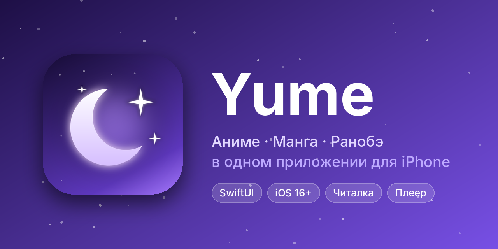

<div align="center">



# Yume

**Аниме, манга и ранобэ в одном нативном приложении для iPhone**

[](https://github.com/lanc1r-png/hehe-ios/actions/workflows/build-ipa.yml)


</div>

---

## О проекте

Yume — неофициальный клиент для iPhone, написанный целиком на SwiftUI. Смотри аниме, читай мангу и ранобэ в быстром интерфейсе с тёмной и светлой темами, своим акцентным цветом и аккуратными анимациями.

> Приложение личное и не связано с сайтами-источниками. Все материалы принадлежат их правообладателям.

## Возможности

<table>
<tr>
<td width="33%" valign="top">

### 🎬 Аниме
- каталог, поиск и фильтры
- плеер с выбором качества и озвучки
- картинка в картинке
- продолжение с места остановки
- следующая серия сама
- «Продолжить смотреть» с удалением по тайтлу

</td>
<td width="33%" valign="top">

### 📖 Манга и манхва
- режимы «Страницы» и «Лента»
- три вида листания, зум, нижний слайдер
- фон под страницу: белый или чёрный по краям
- автопрокрутка ленты с регулировкой скорости
- комментарии к главе и к странице
- закладки на страницы

</td>
<td width="33%" valign="top">

### 📚 Ранобэ
- постраничная читалка в стиле книги
- темы, шрифты, интервал, размер текста
- выделения цветом и заметки
- поиск по тексту главы
- закладки и офлайн-чтение

</td>
</tr>
</table>

### Для всех разделов

| | |
|---|---|
| ❤️ **Избранное** | списки «Смотрю / В планах / Просмотрено / Брошено», сортировка, кнопка «Продолжить» на обложке |
| 👤 **Профиль** | вход через сайт, ваши списки, серия дней, уровень |
| 👥 **Друзья** | список друзей, статус «в сети», их списки и тайтлы |
| 🔗 **Связанное и похожие** | отдельные панели на странице тайтла, без длинной прокрутки |
| 🧑‍🎨 **Авторы** | все работы автора |
| ⬇️ **Загрузки** | скачивание глав манги и ранобэ, лимит места, автоудаление прочитанного |
| 📊 **Статистика** | сколько просмотрено и прочитано |
| ☁️ **Резервная копия** | прогресс, избранное и настройки сохраняются в iCloud Drive и восстанавливаются после переустановки |
| 🎨 **Оформление** | акцентный цвет, тема, тактильный отклик |

## Установка

Приложение собирается без подписи, поэтому его ставят через стороннюю подпись.

1. Открой вкладку **[Actions](../../actions)** и выбери последнюю успешную сборку.
2. Внизу страницы скачай артефакт **Hehe-unsigned-ipa** и распакуй архив.
3. Установи `Hehe.ipa` на iPhone через AltStore, Sideloadly или другой инструмент для установки IPA со своей подписью.

## Сборка

Проект описан в `project.yml` и собирается через [XcodeGen](https://github.com/yonaskolb/XcodeGen).

```bash
brew install xcodegen
xcodegen generate
open Hehe.xcodeproj
```

Сборку на GitHub запускает любой push: [`build-ipa.yml`](.github/workflows/build-ipa.yml) собирает неподписанный IPA и кладёт его в артефакты.

## Структура

```
Hehe/App.swift          код приложения (SwiftUI)
project.yml             описание проекта для XcodeGen
icon-1024.png           иконка приложения
assets/                 баннер и картинки для README
.github/workflows/      сборка IPA
```

## Технологии

SwiftUI · NavigationStack · AVKit / AVPlayerViewController · TextKit · WebKit · Network · URLSession · XcodeGen · GitHub Actions

---

<div align="center">
<sub>Сделано с любовью к хорошему вечеру с аниме 🌙</sub>
</div>
